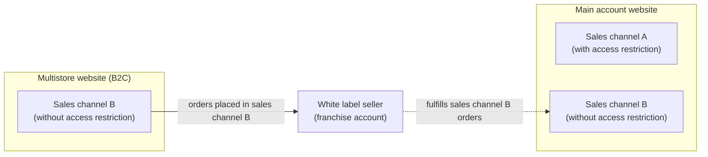
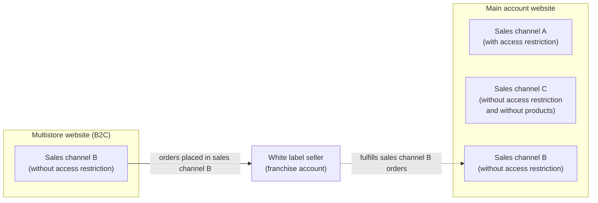

Your brand main account website should have restricted access, but logged-out users see products and information from a sales channel without access restriction. This issue can occur when a [white label seller](/en/docs/tutorials/white-label-seller), such as a [franchise account](/en/docs/tutorials/what-is-a-franchise-account), fulfills orders from one of your store websites, such as a [multistore](/en/docs/tutorials/managing-a-multistore) website.

## Cause

For a white label seller to fulfill orders for your store, the sales channel it serves must be eligible in the [binding](/en/docs/tutorials/how-the-relationship-between-websites-and-business-policies-works#eligibility-rule) of the **main account**, even if the seller only delivers orders from another website. Being eligible in the binding means that the sales channel is selected in the binding configuration of the main account website, allowing that website to render information for that sales channel.

When the main account sales channel has access restriction, as in B2B operations, this rule combines with the [exception to the priority rule](/en/docs/tutorials/how-the-relationship-between-websites-and-business-policies-works#exception-to-the-priority-rule): If a sales channel with access restriction is above an eligible sales channel without restriction, the rendered sales channel is the one without restriction. As a result, logged-out users see the main account website with the information of the sales channel without access restriction, which was originally intended for another website.

### Example

Consider a brand with the following architecture:

- **Main account website:** Sales channel A (with access restriction). Only sales channel A is eligible in the binding of this website, and it has its own inventory.
- **Multistore website:** Sales channel B (without access restriction). Only sales channel B is eligible in the binding of this website. The catalog is shared with the main account. Sales channel B has no access restriction because, in this example, it serves an additional B2C website that must be accessible to logged-out users.
- **White label seller:** Franchise account that only fulfills orders placed in sales channel B.

For the white label seller to deliver the multistore orders, sales channel B must also be eligible in the binding of the main account. The following diagram illustrates this architecture:

The sales channel order is configured as follows:

1. Sales channel A (with access restriction)
2. Sales channel B (without access restriction)

Based on the priority rule, the main account website would render sales channel A, which is at the top of the order. However, sales channel A has access restriction, and sales channel B, which is below it, doesn't. In this case, the exception to the priority rule applies. As a result, logged-out users, who don't meet the access conditions of sales channel A, see the main account website with the information of sales channel B.

## Solution

To prevent logged-out users from seeing the information of sales channel B on the main account website, follow the steps below. You'll create a sales channel without products and place it before sales channel B in the order.

1. [Create a sales channel](/en/docs/tutorials/creating-a-trade-policy) C, without access restriction.
2. Make sales channel C eligible in the binding of the main account. Learn how in **step 8** of the article [Linking a store to a folder structure in CMS (binding)](/en/docs/tutorials/linking-an-account-name-to-a-website-binding).
3. In the VTEX Admin, go to **Store Settings > Channels > Sales Channels**.
4. In the **Position** column, set sales channel C to a position before sales channel B.

> ⚠️ Don't make products available for sales channel C. It must remain without products so that the main account website doesn't display information to logged-out users.

With this configuration, the sales channel order is as follows:

1. Sales channel A (with access restriction)
2. Sales channel C (without access restriction and without products)
3. Sales channel B (without access restriction)

The following diagram illustrates this configuration. Sales channel C is eligible in the binding of the main account, between sales channel A and sales channel B, and has no products:

This way, logged-out users access the main account website without products, because sales channel C (without access restriction) is rendered.

Sales channel B remains eligible in this binding so that the white label seller can fulfill the multistore orders. It isn't rendered because it's below sales channel C in the order.

After logging in, users who meet the access restriction conditions see the products with the information of sales channel A.
