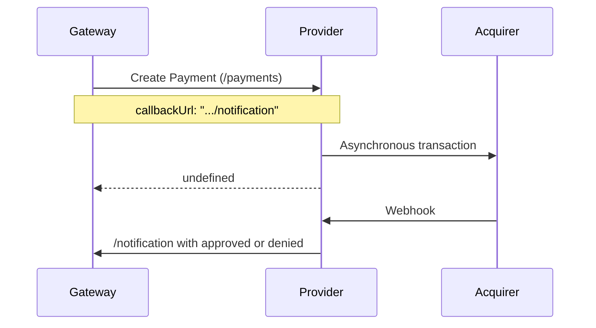
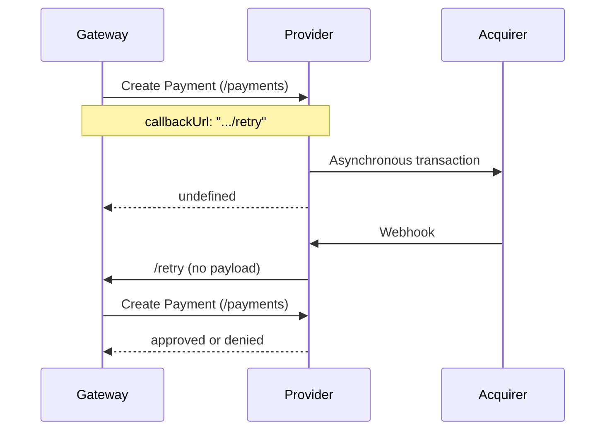

The Payment Provider Protocol (PPP) is the integration protocol between VTEX and other companies that process payments.

Through it, VTEX offers a public contract available to all providers that want to integrate into our platform. As a result, providers become more autonomous regarding such integration.

The protocol has the following features:

- Online homologation process.
- Pre-authorization support (2-step capture).
- Payment authorization retry mechanism.
- Payment redirection flow support (3P).
- OAuth protocol support for authentication.

The protocol's operation is detailed in the [Payment protocol flow](/en/docs/tutorials/payment-provider-protocol#payment-protocol-flow) section, and the endpoints are described in the [Payment Provider Protocol API reference](https://developers.vtex.com/docs/api-reference/payment-provider-protocol).

## Concepts

**Provider:** Payment system, gateway, or company that processes payments.

**Payment Provider Protocol:** Integration protocol developed by VTEX.

**Connector:** Name of the partner provider that integrates with VTEX.

**OAuth:** Authorization protocol for web APIs designed to allow client applications to access a protected resource on behalf of a user.

**Acquirer:** Company that specializes in processing payments. It transfers the amounts charged to the customer by the issuing bank to your store's account.

## Implementation prerequisites

### Signing a business partnership agreement for financial services

For implementing, publishing, and updating a payment connector on VTEX, you need to sign a partnership agreement for financial services that covers the particularities of this domain and the regulations within the platform. If you don't have a partnership agreement yet but want to become a payment provider, contact our team through the [website](https://vtex.com/us-en/partners).

### Having access to a VTEX environment

To publish a connector, you need a VTEX environment, which is only provided after you sign the partnership agreement for financial services. This environment allows you to publish, homologate, and update the connector, and gives you access to our support for development and maintenance.

If the partner is an SI (Service Implementer) developing integrations for clients or other payment providers, the VTEX account used must belong to the main payment method provider, not to the contracted agency.

### Payment method requirements

#### Payment providers with credit, debit or cobranded cards (solutions without redirect)

To become an integrated VTEX provider, you must use one of the following solutions:

- The infrastructure where the connector will be built must have the PCI-DSS certificate signed by a QSA (Qualified Security Assessor). Learn more in [PCI Security Standards Council](https://www.pcisecuritystandards.org/).
- If you don't have the certificate, implement the provider using [Secure Proxy](https://developers.vtex.com/docs/guides/payments-integration-secure-proxy).

If the provider is certified or has already started the certification process, you can contact the VTEX commercial team to begin the integration.

The provider must forward the [AOC](https://www.pcisecuritystandards.org/document_library) (Attestation of Compliance for Onsite Assessments - Service Provider Version) fully completed to VTEX, observing the following points:

- **Company name**: The "URL" field (Part 1a.) must be the same as that of the company requesting the integration procedure. If another name is entered in this field (for example, a company acquired by another one), you'll need to send additional documentation that proves the relationship between the companies and that the provider's service URL was assessed by the PCI DSS.
- **Signature**: Document signed by the company representative and the QSA.
- **Expiration date**: The AOC is valid for 1 year after the signing date. An AOC issued more than 11 months ago (that is, less than 30 days before its expiration date) must not be sent to VTEX.

> ⚠️ Whenever you need to update a connector that processes payments with credit, debit, or cobranded cards, you'll have to repeat the [homologation](https://developers.vtex.com/docs/guides/payments-integration-payment-provider-homologation) process (open a ticket and submit the AOC), except when the connector simultaneously meets all the [homologation exemption conditions](https://developers.vtex.com/docs/guides/payments-integration-payment-provider-homologation#when-is-payment-provider-homologation-not-required).

> ❗ The SAQ (Self-Assessment Questionnaire) and AOC (Attestation of Compliance for Onsite Assessments – Merchants Version) documents aren't accepted in the VTEX integration process.

#### Payment providers with notes payables, Brazilian boleto or private label cards (or providers of any kind of card using redirect solutions)

For boleto, notes payable, or private-label card providers, as well as other cards processed through redirect solutions, VTEX doesn't require proof of PCI DSS certification. Just contact the VTEX commercial team to begin the integration.

## First steps

Below is the step-by-step process for integrating payments with VTEX.

### 1. Implementing the protocol

Before setting up the VTEX environment, the provider must implement the backend service (API) to receive and process payments. The endpoints this service must support are described in the [Implementing a payment provider](https://developers.vtex.com/docs/guides/payments-integration-implementing-a-payment-provider) guide.

### 2. Specific use cases

In some cases, connectors can be built for a specific solution, such as those described below:

- [Payment Provider Framework (PPF)](https://developers.vtex.com/docs/guides/payments-integration-payment-provider-framework): Solution for implementing connectors through VTEX IO from a boilerplate, which already comes with most of the work done, including the protocol endpoints. VTEX IO also speeds up the development process and in-store testing.
- [Payment Provider Protocol applied to POS payments - VTEX Sales App](https://developers.vtex.com/docs/guides/payments-integration-ppp-applied-to-pos): Application of PPP for credit and debit card payments in physical stores using a payment terminal (POS). The payment flow starts with a purchase made on [VTEX Sales App](/en/docs/tracks/what-is-vtex-sales-app), then communication is established with the POS, where the customer inserts the card.

### 3. Payment Provider homologation

After receiving the access details and implementing the backend, the provider must install the Payment Provider Test Suite app, available in the [VTEX App Store](https://apps.vtex.com/vtex-payment-provider-test-suite/p), to access the testing tool.


> ⚠️ To pass the homologation process, you need to implement specific logic to handle the test requirements. When sending requests to Test Suite, use the extra header `X-VTEX-API-Is-TestSuite = true` to identify them and mask any required case.<br>All communication with servers, whether during the homologation process or in production, must use HTTPS on port 443 and support TLS 1.2.

After installing, access the app in the VTEX Admin at **Apps > Payment Provider Test Suite**. If the app doesn't appear in the menu, go to `https://{accountName}.myvtex.com/admin/test-suite/payment-provider`, replacing `{accountName}` with your store's account name.

The app displays a form with three sections: **Service information**, **Payment method**, and **Test cases**. Complete the fields following the instructions below.

#### Service information

- **Service URL:** Define the URL of your provider service. This URL will be the base address for the protocol and must follow its format. For example, if the service URL is `https://example.com/`, the full URL for the `/payments` endpoint will be `https://example.com/payments`.
- **Test with AppKey and AppToken:** This button allows you to choose whether to configure the values of these fields, which can make testing easier during development. If you don't activate this option, the credentials are sent in the headers as an empty string.

> ℹ️ The gateway stores the store credentials configured in the affiliation and sends them in the `X-VTEX-API-AppKey` and `X-VTEX-API-AppToken` headers. The exceptions are integrations developed with VTEX IO, for which the headers are sent as `x-provider-api-appKey` and `x-provider-api-appToken`. If you're developing with the [Payment Provider Framework (IO)](https://developers.vtex.com/docs/guides/payments-integration-payment-provider-framework), this is configured by the `usesProviderHeadersName` option, described in [Payment Provider Framework configurable options](https://developers.vtex.com/docs/guides/payments-integration-payment-provider-framework#available-configurable-options).

#### Payment method

After you complete the Service URL field, Test Suite validates the [List Payment Provider Manifest](https://developers.vtex.com/docs/api-reference/payment-provider-protocol#get-/manifest) endpoint and checks the declared payment methods, which appear as options in this field. Select the payment methods you want to test.

#### Test cases

In this section, you need to select the cases you want to test. If you're testing a credit card method, your integration must pass the Approved, Denied, Cancellation, Async Approved, and Async Denied cases. Only the Redirect flow is required for a payment method with [redirect](https://developers.vtex.com/docs/guides/payments-integration-purchase-flows#redirect).


### 4. Testing

When you click the `Run Test` button, Test Suite calls the provided **Service URL** and runs the selected test cases. All tests start with a [Create Payment](https://developers.vtex.com/docs/api-reference/payment-provider-protocol#post-/payments) request to `{ServiceURL}/payments` and are divided into two groups, according to how the provider reports the final payment status.

In synchronous tests, the provider reports the final status in the response to the Create Payment request itself:

- **Approved flow:** The response must contain the `approved` status. Then, Test Suite sends a [Settle Payment](https://developers.vtex.com/docs/api-reference/payment-provider-protocol#post-/payments/-paymentId-/settlements) request to `{ServiceURL}/payments/{paymentId}/settlements`, expecting a response with a completed `settleId` field, and a [Refund Payment](https://developers.vtex.com/docs/api-reference/payment-provider-protocol#post-/payments/-paymentId-/refunds) request to `{ServiceURL}/payments/{paymentId}/refunds`, expecting a response with a completed `refundId` field.
- **Denied flow:** The response must contain the `denied` status.
- **Cancellation flow:** The response must contain the `approved` status. Then, Test Suite sends a [Cancel Payment](https://developers.vtex.com/docs/api-reference/payment-provider-protocol#post-/payments/-paymentId-/cancellations) request to `{ServiceURL}/payments/{paymentId}/cancellations`, expecting a response with the `canceled` status.

In asynchronous tests, the provider responds to the Create Payment request with the `undefined` status and, after 15 seconds, sends the final status in a response with the same format via a `POST` to the URL in the `callbackUrl` field:

| Test                | Response to the Create Payment request                                                     | Status sent to `callbackUrl` |
| ------------------- | ------------------------------------------------------------------------------------------ | ---------------------------- |
| Async approved flow | `undefined`                                                                                | `approved`                   |
| Async denied flow   | `undefined`                                                                                | `denied`                     |
| Boleto flow         | `undefined`, with the boleto URL entered in the `bankIssueInvoiceUrl` field                | `approved`                   |
| Redirect flow       | `undefined`, with the URL used to redirect the customer entered in the `redirectUrl` field | `approved`                   |

With the integration in production, the call to `callbackUrl` must be authenticated with the partner's [VTEX credentials](#vtex-credentials). You can learn more about the callback flow in the [Payment Authorization](#payment-authorization) section.

To identify how to correctly respond to each credit card test, use the following card numbers:

| Card number      | Response status                                   |
| ---------------- | ------------------------------------------------- |
| 4444333322221111 | `approved`                                        |
| 4444333322221112 | `denied`                                          |
| 4222222222222224 | `undefined`, `callbackUrl` with `approved` status |
| 4222222222222225 | `undefined`, `callbackUrl` with `denied` status   |

### 5. Results

After running the tests, the system displays the Test Report, where you can see detailed results for each test case and identify what needs to be adjusted if an error occurs.


To see the messages exchanged between Test Suite and the payment provider implementation, click the Inspect Log button for the test case you want. A modal will open showing the message list and the payload of each request and response. The button in the upper right corner of the code section allows you to copy the code to the clipboard.


If any test case fails, adjust the connector and run the tests again. When all cases pass, [open a ticket with VTEX Support](/en/docs/tutorials/opening-tickets-to-vtex-support) stating that the integration is complete, since VTEX only recognizes the implementation after this ticket is opened. If the connector processes payments with credit, debit, or co-branded cards, also attach the AOC to the ticket. The information the ticket must contain is listed in the [Payment provider homologation](https://developers.vtex.com/docs/guides/payments-integration-payment-provider-homologation#request-homologation) guide, and the Payments team completes the homologation within 30 days after the partnership agreement for financial services is sent.

## Payment protocol flow

This section explains the integrated payment flow in detail. It all starts with requesting a new payment after creating a new order. VTEX creates a new payment representation and proceeds to payment processing, as shown in the image below, which also shows your provider's responsibilities.


> ℹ️ The default period of 7 days for asynchronous payment retries is only applied when the user doesn't specify a value in the `delayToCancel` field of the [Create Payment](https://developers.vtex.com/docs/api-reference/payment-provider-protocol#post-/payments) endpoint or when sending the callbackURL.

> ⚠️ The maximum value allowed for the `delayToCancel` field is 30 days (2592000 seconds). However, for Pix payments (Brazil), the values must be set between 15 and 60 minutes (900 and 3600 seconds).

### Payment authorization

At this point, VTEX calls the `/payments` endpoint and sends a payload with the payment data to your provider. The provider must process this data and send back the response, which must contain one of the status values: `approved`, `denied`, or `undefined`.

The `undefined` status represents the state in which the provider couldn't finish processing the payment, either due to a long processing time or to asynchronous processing.

In either case, when processing is complete and the provider has a final status (`approved` or `denied`), it must call the `callbackUrl` sent in the body of the `/payments` request. There are two possible flows when using the `callbackUrl` depending on whether your integration is hosted on the partner infrastructure or on VTEX IO:

- **Without VTEX IO:** `callbackUrl` contains a callback endpoint for the provider to notify the gateway of the updated status.
- **With VTEX IO:** `callbackUrl` contains a **retry** endpoint. When the provider uses this endpoint to call the gateway, the gateway makes a new Create Payment (/payments) request to the provider, and the provider returns the updated payment status in response.

The complete flow with `undefined` status and notification is shown below:



1. The payment authorization is initiated when the gateway calls the provider's Create Payment (`/payments`) endpoint. The `callbackUrl` field in the request body contains the URL for sending the notification.
2. The payment occurs asynchronously (it doesn't generate the final status when the transaction is initiated). The gateway then receives the response with `undefined` status and waits for payment processing to complete before updating it with the final status (`approved` or `denied`).
3. When the payment is processed, the acquirer triggers a webhook to the provider with the new status.
4. The provider, upon receiving the call through the webhook, calls the notification endpoint and returns the updated status to the gateway.

The complete flow with `undefined` status and **retry** is shown below:



1. The payment authorization is initiated when the gateway calls the provider's Create Payment (`/payments`) endpoint. The `callbackUrl` field in the request body contains the URL of the **retry** endpoint.
2. The payment occurs asynchronously (it doesn't generate the final status when the transaction is initiated). The gateway then receives the response with `undefined` status and waits for payment processing to complete before updating it with the final status (`approved` or `denied`).
3. When the payment is processed, the acquirer triggers a webhook to the provider with the new status.
4. Upon receiving the webhook call, the provider calls the gateway's **retry** endpoint, which doesn't require a payload, so that the gateway calls the `/payments` endpoint again.
5. The gateway calls the `/payments` endpoint again and receives the provider's response with the new status (`approved` or `denied`).

## Callback URL

The `callbackUrl` field contains a URL that the payment provider uses to make a callback and inform our gateway of the final payment status: `approved` or `denied`.

This URL has some query parameters, including the `X-VTEX-signature`. This parameter is mandatory and contains a signature token of up to 32 characters that identifies, as a security measure, that the request was generated by VTEX. You can check an example of callback URL with the signature token below:

```
https://gatewayqa.vtexpayments.com.br/api/pvt/payment-provider/transactions/8FB0F111111122222333344449984ACB/payments/A2A9A25B11111111222222333327883C/callback?accountName=teampaymentsintegrations&X-VTEX-signature=R123456789aBcDeFGHij1234567890tk
```

In the [Transactions page of the Admin](/en/docs/tutorials/how-to-view-the-orders-details), the signature token appears masked for security reasons, as in this example: `X-VTEX-signature=Rj******tk`.

The example below shows a payload sent along with the callback URL:

```json
{"paymentId":"8B3BA2F4352545A8B1C5A215F356A01C","status":"approved","authorizationId":"184520","nsu":"21705348","tid":"21705348","acquirer":"pagarme","code":"0000","message":"Transaction successfully approved","delayToAutoSettle":1200, "delayToAutoSettleAfterAntifraud":1200, "delayToCancel":86400,"cardBrand":"Mastercard","firstDigits":"534696","lastDigits":"6921","maxValue":16.6}
```

> ℹ️ The parameter values sent in the callback payload replace the original values informed in the [Create Payment](https://developers.vtex.com/docs/api-reference/payment-provider-protocol#post-/payments) request.

> ⚠️ If the waiting parameters (_delayToAutoSettle_ and _delayToAutoSettleAfterAntifraud_) aren't sent with the callback URL, these values will be automatically set to 24 hours.

When making the callback request, we recommend that payment providers use the callback URL exactly as received to ensure all parameters are included. This request must be authenticated as described in the [VTEX credentials section](/en/docs/tutorials/payment-provider-protocol#vtex-credentials).

> ❗ In addition to the callback URL, if the status is `undefined`, VTEX will try again to call the payment authorization endpoint. If the status returned on these calls remains `undefined`, calls will continue for up to 7 days. That's why it's important for your provider to be ready to receive the same payment authorization several times and, if the transaction has already been created, respond with its status in subsequent calls.

Once the payment has been processed by your provider, either directly or asynchronously, we update the payment transaction in VTEX to the _authorized_ or _canceled_ status, depending on the processing response.

For more details about the authorization request, see the [Create Payment](https://developers.vtex.com/docs/api-reference/payment-provider-protocol#post-/payments) endpoint.

### Refund/Cancellation

After the first call for payment authorization, the store may cancel the order at any time. At the time of cancellation, the following situations may occur:

1. **Payment transaction has already been settled**: The cancellation request will then result in a refund call to the provider's `/payments/{id}/refunds` endpoint, where `{id}` is the payment ID in VTEX.
2. **Payment transaction hasn't been settled yet**: We'll call the provider's `/payments/{id}/cancellations` endpoint, where `{id}` is the payment ID in VTEX. If there's any difficulty in processing the automatic cancellation, an email will be sent to the merchant so that they can cancel it manually.

The Payment Provider Protocol also allows partial refunds. For example, if after a USD 1,000 purchase is completed, it's necessary to refund USD 300 to the customer, there are two possible scenarios:

1. **Payment has already been settled**: A partial refund of USD 300 will be made to the customer. The remaining amount (USD 700) remains at the merchant's disposal.
2. **Payment hasn't been settled yet**: A settlement cancellation of USD 300 and a partial settlement approval of USD 700 will be made for the merchant.

For more details, see the [Cancel Payment](https://developers.vtex.com/docs/api-reference/payment-provider-protocol#post-/payments/-paymentId-/cancellations) and [Refund Payment](https://developers.vtex.com/docs/api-reference/payment-provider-protocol#post-/payments/-paymentId-/refunds) endpoints.

### Settlement

If the payment transaction is authorized in the VTEX gateway, it can receive settlement requests. When we receive a settlement request, we call the provider's `/payments/{id}/settlements` endpoint, where `{id}` is the payment ID in VTEX.

When the provider receives a request for settlement, it must settle the payment and respond with settlement information. If this call fails, we retry for up to 1 day.

> ❗ Your provider must be prepared to receive the same settlement call multiple times and, if the payment has already been settled, send the same settlement response in subsequent calls.

If the settlement call works fine, we move the payment transaction to the _Finished_ status, and the flow ends successfully.

For more details, see the [Settle Payment](https://developers.vtex.com/docs/api-reference/payment-provider-protocol#post-/payments/-paymentId-/settlements) endpoint.

## VTEX credentials

When calling the `callbackUrl`, you must send the `X-VTEX-API-AppKey` and `X-VTEX-API-AppToken` authentication headers with an API key and token from your VTEX partner account. These credentials are unique to your account and must not be confused with the store credentials that the gateway sends to the provider.

To generate the credentials, go to **Account settings > API keys** in the VTEX Admin and follow the instructions in the [API authentication using API keys](https://developers.vtex.com/docs/guides/api-authentication-using-api-keys) article.
