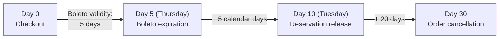

When a boleto (for stores in Brazil) for an order isn't paid, the order is automatically canceled. The total time before cancellation is the sum of the following periods:

- [Boleto validity period](#boleto-validity-period)
- [Product reservation release period](#product-reservation-release-period)
- [Order cancellation period](#order-cancellation-period)

## Boleto validity period

The boleto validity period is the number of days the customer has to pay the boleto after it's issued. Once the validity period ends, the boleto can no longer be paid.

Some payment providers allow you to configure the boleto validity period in the VTEX Admin. To check if your payment provider offers this option, follow the steps below:

1. In the VTEX Admin, go to **Store Settings > Payment > Providers**, or type **Providers** in the search bar at the top of the page.
2. On the providers page, enter the provider name and click it.
3. On the provider configuration page, check if there's a field to configure the boleto validity period.
4. Enter the desired validity period in days.
5. Click `Save`.

> ⚠️ If your payment provider doesn't allow you to configure the boleto validity period in the VTEX Admin, contact the provider's technical support to configure it.

## Product reservation release period

To prevent an unpaid order from affecting store operations, the reservation of purchased products is released even if the order remains pending payment. The reservation release period is the **boleto validity period + four, five, or six calendar days**, depending on the day of the week the validity period ends:

| Boleto expiration day | Calendar days added to the validity period | Reservation release day |
| :-------------------- | :----------------------------------------- | :---------------------- |
| Sunday                | 4                                          | Thursday                |
| Monday                | 4                                          | Friday                  |
| Tuesday               | 4                                          | Saturday                |
| Wednesday             | 5                                          | Monday                  |
| Thursday              | 5                                          | Tuesday                 |
| Friday                | 5                                          | Wednesday               |
| Saturday              | 6                                          | Friday                  |

For more information about product reservation, see [How the reservation works](/en/docs/tutorials/how-does-reservation-work).

## Order cancellation period

The order is canceled 20 days after the reservation is released, meaning the total time before cancellation is the **reservation release period + 20 days**.

For example, an order without payment whose boleto has a 5-day validity, expiring on a Thursday, is canceled 30 days after the purchase is completed:

- Boleto validity period = 5 days.
- Reservation release period = 5 + 5 = 10 days.
- Order cancellation period = 10 + 20 = 30 days.

The following timeline shows the periods in this example, counted from the moment the purchase is completed:

Until cancellation, you can still approve the order's boleto payment, as described in [Approving boleto payments (for stores in Brazil)](/en/docs/tutorials/approving-payment-of-the-bank-payment-slip). To cancel the order before then, see [How to cancel orders](/en/docs/tutorials/canceling-orders).
