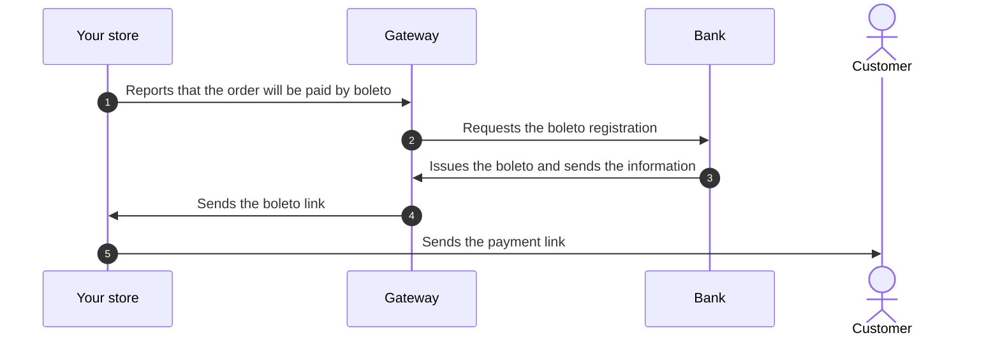
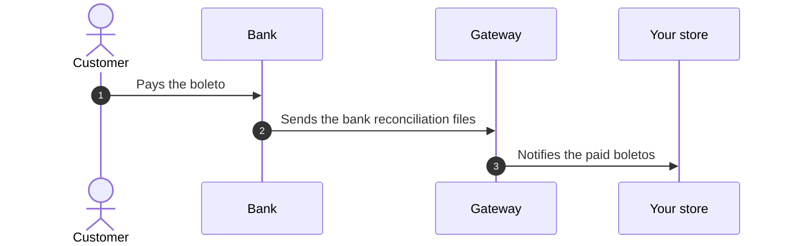

Registered boleto is a Brazilian payment method that customers can use to complete purchases in your store. Before the boleto is issued, the bank registers it with the customer's data, such as name and CPF (Brazilian taxpayer ID), which are also displayed on the boleto. To prevent fraudsters from accessing this information, the store asks the customer to log in when they choose registered boleto as the payment method and when they download the boleto on the order confirmation page (**Order Placed**).

To issue registered boletos, your store must have a contract with a bank or payment provider that issues this type of boleto, add this provider in the VTEX Admin, and create a boleto payment condition processed by it. The steps are described in [Configuring a boleto](/en/docs/tutorials/how-to-configure-a-boleto).

The basic flow of a registered boleto payment is divided into two parts: [Issuing the boleto](#issuing-the-boleto) and [Boleto payment and bank reconciliation](#boleto-payment-and-bank-reconciliation).

## Issuing the boleto

The following diagram shows how the boleto is issued, from the request made by your store to the link sent to the customer:

1. Your store informs the gateway that an order will be paid by boleto.
2. The gateway contacts the bank to register the boleto.
3. The bank issues the boleto and sends its information to the gateway.
4. The gateway generates the boleto link and sends it to your store.
5. Your store sends the boleto link to your customer so they can pay.

At this point, the customer hasn't paid the boleto yet.

## Boleto payment and bank reconciliation

The following diagram shows how the boleto is paid and reconciled, from the payment made by the customer to the notification sent to your store:

1. The customer pays the boleto directly to the bank.
2. The bank sends the gateway the [bank reconciliation](/en/docs/tutorials/bank-reconciliations) files with information about the payment status of the boletos.
3. The gateway notifies your store about the paid boletos.

With this notification, the payment is approved on VTEX and the order can proceed to delivery as usual. Until then, the order remains in the **Payment Pending** status, as described in [How are the payments made through Boletos approved?](/en/docs/tutorials/how-are-the-payments-made-through-boletos-approved). If the customer doesn't pay the boleto by the due date, the order is canceled after the time frames described in [How long does it take to cancel an order with an unpaid boleto?](/en/docs/tutorials/how-long-does-it-take-to-cancel-an-order-with-an-unpaid-boleto).
