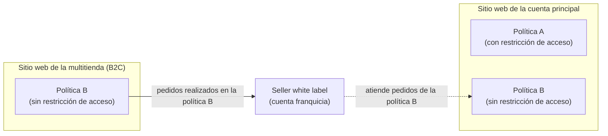
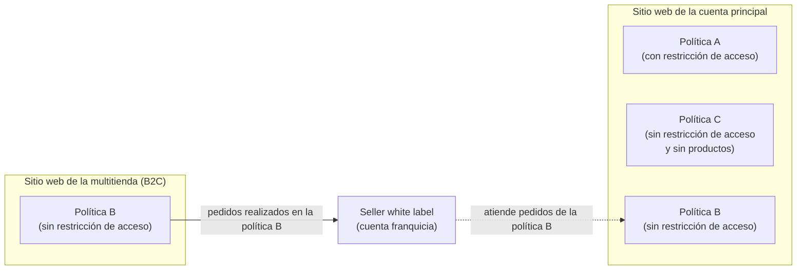

El sitio web de la cuenta principal de tu marca debería tener acceso restringido, pero los usuarios no conectados ven productos e información de una política comercial sin restricción de acceso. Este problema puede ocurrir cuando un [seller white label](/es/docs/tutorials/seller-white-label), como una [cuenta franquicia](/es/docs/tutorials/que-es-una-cuenta-franquicia), realiza el fulfillment de pedidos de un sitio web de tu tienda, como el de una [multitienda](/es/docs/tutorials/gestionar-multitienda).

## Causa

Para que un seller white label realice el fulfillment de pedidos de tu tienda, la política comercial atendida por el seller debe estar elegible en el [binding](/es/docs/tutorials/como-funciona-la-relacion-entre-sitios-web-y-politicas-comerciales#regla-de-elegibilidad) de la **cuenta principal**, aunque entregue solo los pedidos de otro sitio web. Estar elegible en el binding significa que la política comercial está marcada en la configuración del binding del sitio web de la cuenta principal, lo que permite que ese sitio web muestre la información de esa política.

Cuando la política comercial de la cuenta principal tiene restricción de acceso, como en operaciones B2B, esta regla se combina con la [excepción a la regla de prioridad](/es/docs/tutorials/como-funciona-la-relacion-entre-sitios-web-y-politicas-comerciales#excepcion-a-la-regla-de-prioridad): si una política con restricción de acceso está por encima de una política elegible sin restricción, la política mostrada será la que no tiene restricción. Por eso los usuarios no conectados ven el sitio web de la cuenta principal con la información de la política sin restricción de acceso, que originalmente estaba destinada a otro sitio web.

### Ejemplo

Considera una marca con la siguiente arquitectura:

- **Sitio web de la cuenta principal:** política A (con restricción de acceso). Solo la política A está elegible en el binding de este sitio web, y tiene stock propio.
- **Sitio web de la multitienda:** política B (sin restricción de acceso). Solo la política B está elegible en el binding de este sitio web. El catálogo se comparte con la cuenta principal. La política B no tiene restricción de acceso porque, en este ejemplo, atiende un sitio web adicional B2C, que debe estar accesible para usuarios no conectados.
- **Seller white label:** cuenta franquicia que realiza el fulfillment únicamente de los pedidos realizados en la política B.

Para que el seller white label entregue los pedidos de la multitienda, la política B también debe estar elegible en el binding de la cuenta principal. El siguiente diagrama ilustra esta arquitectura:

El orden de las políticas comerciales está configurado de la siguiente forma:

1. Política A (con restricción de acceso)
2. Política B (sin restricción de acceso)

Por la regla de prioridad, el sitio web de la cuenta principal mostraría la política A, que está en la parte superior del orden. Sin embargo, la política A tiene restricción de acceso y la política B, que está debajo de ella, no tiene. En ese caso, entra en vigor la excepción a la regla de prioridad. Como resultado, los usuarios no conectados, que no cumplen con las condiciones de acceso de la política A, ven el sitio web de la cuenta principal con la información de la política B.

## Solución

Para que los usuarios no conectados no vean la información de la política B en el sitio web de la cuenta principal, sigue estos pasos. Debes crear una política comercial sin productos y posicionarla antes de la política B en el orden.

1. [Crea una política comercial](/es/docs/tutorials/crear-una-politica-comercial) C sin restricción de acceso.
2. Haz elegible la política C en el binding de la cuenta principal. Las instrucciones se describen en el **paso 8** del artículo [Vincular una tienda a una estructura de carpetas de CMS (binding)](/es/docs/tutorials/vincular-un-account-name-a-un-website-binding).
3. En el Admin VTEX, accede a **Configuración de la tienda > Canales > Políticas comerciales**.
4. En la columna **Posición** define la política C con una posición anterior a la de la política B.

> ⚠️ No disponibilices productos para la política C. Debe permanecer sin productos para que el sitio web de la cuenta principal no muestre información a usuarios no conectados.

Con esta configuración, el orden de las políticas comerciales queda de la siguiente forma:

1. Política A (con restricción de acceso)
2. Política C (sin restricción de acceso y sin productos)
3. Política B (sin restricción de acceso)

El siguiente diagrama ilustra esta configuración. La política C queda elegible en el binding de la cuenta principal, entre la política A y la política B, y no tiene productos:

De esta forma, los usuarios no conectados acceden al sitio web de la cuenta principal sin productos, ya que se muestra la política C (sin restricción de acceso).

La política B permanece elegible en ese binding para que el seller white label realice el fulfillment de los pedidos de la multitienda. No se muestra porque está debajo de la política C en el orden.

Después del inicio de sesión, los usuarios que cumplen con las condiciones de restricción de acceso ven los productos con la información de la política A.
