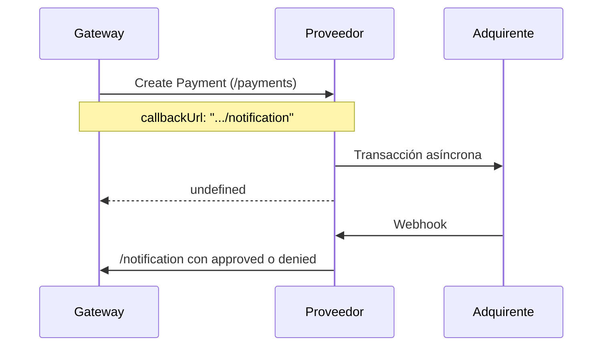
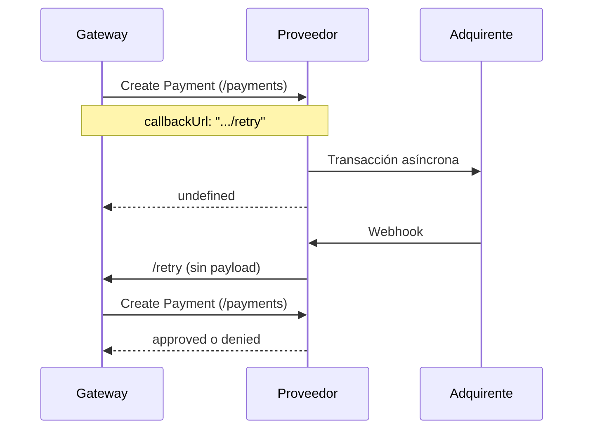

Payment Provider Protocol es el protocolo de integración entre VTEX y otras empresas que procesan pagos.

Es la manera en que VTEX ofrece un contrato público disponible para todos los proveedores que desean integrarse a nuestra plataforma. Así, los proveedores obtienen mayor autonomía en relación con la integración.

El protocolo cuenta con los siguientes recursos:

- Proceso de homologación online.
- Soporte para preautorización (captura de 2 pasos).
- Mecanismo de intento de autorización de pago.
- Soporte para el flujo de redirección de pago (3P).
- Soporte para el protocolo de autenticación OAuth.

El funcionamiento del protocolo se detalla en la sección [Flujo del protocolo de pago](/es/docs/tutorials/payment-provider-protocol#flujo-del-protocolo-de-pago) y los endpoints se describen en la [referencia de la API del Payment Provider Protocol](https://developers.vtex.com/docs/api-reference/payment-provider-protocol).

## Conceptos

**Proveedor:** sistema de pago, gateway o empresa que procesa pagos.

**Payment Provider Protocol:** protocolo de integración desarrollado por VTEX.

**Conector:** nombre del proveedor que es partner de integración con VTEX.

**OAuth:** protocolo de autorización para APIs web diseñado para permitir que las aplicaciones cliente accedan a un recurso protegido en nombre de un usuario.

**Adquirente:** empresa especializada en procesar pagos. Se encarga de transferir a la cuenta de tu tienda los valores cobrados al cliente por el banco emisor.

## Prerrequisitos de implementación

### Un contrato firmado de asociación comercial para servicios financieros

La implementación, publicación y actualización de un conector de pago en VTEX requiere la celebración de un contrato de asociación específico para servicios financieros que cubra los detalles de este escenario y las regulaciones dentro de la plataforma. Si aún no tienes un contrato de asociación, pero estás interesado en convertirte en proveedor de pago, ponte en contacto con nuestro equipo a través de nuestro [sitio web](https://vtex.com/ar-es/partner).

### Acceso a un entorno VTEX

Para publicar un conector necesitas disponer de un entorno VTEX, que solo puedes obtener tras firmar un contrato de asociación para servicios financieros. Este entorno permite publicar, homologar y actualizar el conector además de brindar acceso a nuestro soporte para el desarrollo y mantenimiento.

Si el partner es un SI (Service Implementer, o implementador de servicios) que desarrolla integraciones para clientes u otros proveedores de pago, la cuenta VTEX utilizada debe ser la del proveedor principal del medio de pago y no la de la agencia contratada.

### Requisitos de los medios de pago

#### Proveedores de pago con tarjetas de crédito, débito y cobranded (soluciones transparentes)

Para ser un proveedor VTEX integrado, debes usar una de las siguientes soluciones:

- La infraestructura donde se construirá el conector debe contar con el certificado PCI-DSS firmado por un QSA (Qualified Security Assessor). Más información en el [Consejo de normas de seguridad de PCI](https://www.pcisecuritystandards.org/).
- Si no cuentas con el certificado implementa el proveedor usando [Secure Proxy](https://developers.vtex.com/docs/guides/payments-integration-secure-proxy).

Si el proveedor está certificado o ya inició el proceso de certificación, puede contactar al equipo de negocios de VTEX para comenzar la integración.

El proveedor debe enviar el [AOC](https://www.pcisecuritystandards.org/document_library) (Attestation of Compliance for Onsite Assessments - Service Provider Version) completamente llenado a VTEX. Se debe prestar particular atención a los siguientes puntos:

- **Nombre de la empresa**: el campo "URL" (Parte 1a.) debe ser el mismo de la empresa que solicita el procedimiento de integración. Si se completa con otro nombre (ejemplo: empresa adquirida por otra), será necesario enviar documentación adicional que compruebe la relación entre las empresas y que la URL de servicio del proveedor fue evaluada por el PCI DSS.
- **Firma**: documento firmado por el representante de la empresa y por el QSA.
- **Fecha de vencimiento**: la validez del AOC es de 1 año después de la fecha de firma. No deben enviarse a VTEX AOCs emitidos hace más de 11 meses, es decir, con menos de 30 días para la fecha de vencimiento.

> ⚠️ Siempre que sea necesario actualizar un conector que procese pagos con tarjetas de crédito, débito o co-branded, es obligatorio realizar el proceso de [homologación](https://developers.vtex.com/docs/guides/payments-integration-payment-provider-homologation) nuevamente (abrir un ticket y enviar el AOC), excepto cuando el conector cumpla simultáneamente todas las [condiciones de exención de homologación](https://developers.vtex.com/docs/guides/payments-integration-payment-provider-homologation#when-is-payment-provider-homologation-not-required).

> ❗ Los documentos SAQ (Self-Assessment Questionnaire) y AOC (Attestation of Compliance for Onsite Assessments – Merchants Version) no se aceptan en el proceso de integración de VTEX.

#### Los proveedores de boleto, pagaré o tarjetas de tienda con red propia (private label o tarjetas en general, pero que usan soluciones con redirección)

Para proveedores de boletos, pagarés o tarjetas de tienda con red propia (private label), además de otras tarjetas procesadas en soluciones con redirección, VTEX no solicita la comprobación de certificación PCI DSS. Ponte en contacto con el equipo de negocios de VTEX para iniciar tu integración.

## Primeros pasos

A continuación encontrarás las instrucciones de la integración de pagos con VTEX.

### 1. Implementar el protocolo

Antes de configurar el entorno VTEX, el proveedor debe implementar el servicio backend (API) que recibe y procesa los pagos. Los endpoints que este servicio debe atender están descritos en la guía [Implementing a payment provider](https://developers.vtex.com/docs/guides/payments-integration-implementing-a-payment-provider).

### 2. Casos de uso específicos

Hay casos en que los conectores pueden construirse para atender una solución específica, como los que se describen a continuación:

- [Payment Provider Framework (PPF)](https://developers.vtex.com/docs/guides/payments-integration-payment-provider-framework): solución para implementar conectores a través de VTEX IO a partir de un boilerplate que ya incluye gran parte del trabajo hecho, como los endpoints del protocolo. El uso de VTEX IO también acelera el proceso de desarrollo y pruebas en la tienda.
- [Payment Provider Protocol aplicado a pagos con PDV - VTEX Sales App](https://developers.vtex.com/docs/guides/payments-integration-ppp-applied-to-pos): aplicación del PPP para pagos con tarjetas de crédito y débito en tiendas físicas mediante un terminal de pago (PDV). El flujo de pago comienza con una compra realizada en [VTEX Sales App](/es/docs/tracks/que-es-vtex-sales-app), que luego se comunica con el PDV donde el cliente inserta la tarjeta.

### 3. Homologación de Payment Provider

Después de recibir los datos de acceso e implementar el backend, el proveedor debe instalar la aplicación Payment Provider Test Suite, disponible en [VTEX App Store](https://apps.vtex.com/vtex-payment-provider-test-suite/p), para acceder a la herramienta de pruebas.


> ⚠️ Para completar el proceso de homologación es necesario implementar una lógica específica para abordar los requisitos de la prueba. En las solicitudes enviadas a Test Suite utiliza el encabezado extra `X-VTEX-API-Is-TestSuite = true` para identificarlas y simular cualquier escenario requerido.<br>Toda comunicación con servidores, ya sea durante el proceso de homologación o en producción, debe realizarse vía HTTPS en el puerto 443, con soporte para TLS 1.2.

Tras la instalación accede a la aplicación en el Admin VTEX en **Apps > Payment Provider Test Suite**. Si la aplicación no se muestra en el menú, utiliza la dirección `https://{accountName}.myvtex.com/admin/test-suite/payment-provider` y reemplaza `{accountName}` por el nombre de la cuenta de tu tienda.

La aplicación muestra un formulario con tres secciones: **Información de servicio**, **Medio de pago** y **Casos de prueba**. Llena los campos según las instrucciones a continuación.

#### Información de servicio

- **URL de servicio:** define la URL del servicio de tu proveedor. Esta URL será la dirección base del protocolo y debe seguir el formato determinado por el protocolo. Por ejemplo, si la URL del servicio es `https://example.com/`, la URL completa del endpoint `/payments` será `https://example.com/payments`.
- **Prueba con clave de aplicación y token de aplicación:** este botón de alternancia te permite elegir si deseas configurar los valores de estos campos, lo que puede facilitar las pruebas durante la etapa de desarrollo. Si no se activa esta opción, las credenciales se enviarán en los encabezados como una string vacía.

> ℹ️ El gateway almacena las credenciales de las tiendas configuradas en la afiliación y las envía en los encabezados `X-VTEX-API-AppKey` y `X-VTEX-API-AppToken`. La excepción son las integraciones desarrolladas con VTEX IO, en cuyo caso los encabezados se envían como `x-provider-api-appKey` y `x-provider-api-appToken`. Si utilizas [Payment Provider Framework (IO)](https://developers.vtex.com/docs/guides/payments-integration-payment-provider-framework) para el desarrollo, esto se configura mediante la opción `usesProviderHeadersName`, descrita en las [opciones configurables de Payment Provider Framework](https://developers.vtex.com/docs/guides/payments-integration-payment-provider-framework#available-configurable-options).

#### Medio de pago

Al llenar el campo URL de servicio, Test Suite validará el endpoint [List Payment Provider Manifest](https://developers.vtex.com/docs/api-reference/payment-provider-protocol#get-/manifest) y verificará los medios de pago declarados, que se muestran como opciones en ese campo. Selecciona los medios de pago en los que deseas ejecutar las pruebas.

#### Casos de prueba

En esta sección debes seleccionar los casos que deseas probar. Si estás probando un medio de tarjeta de crédito, tu integración debe obligatoriamente pasar los casos Flujo aprobado, Flujo denegado, Flujo de cancelación, Flujo aprobado asíncrono y Flujo denegado asíncrono. Para un medio de pago con [redirección](https://developers.vtex.com/docs/guides/payments-integration-purchase-flows#redirect) solo se necesita pasar el flujo de redirección.


### 4. Pruebas

Al hacer clic en el botón `Ejecutar prueba`, Test Suite llama a la **URL de servicio** proporcionada y ejecuta los casos de prueba seleccionados. Todas las pruebas comienzan con una solicitud [Create Payment](https://developers.vtex.com/docs/api-reference/payment-provider-protocol#post-/payments) a `{ServiceURL}/payments` y se dividen en dos grupos según la manera en que el proveedor informa el status final del pago.

En las pruebas síncronas, el proveedor informa el status final en la propia respuesta a la solicitud Create Payment:

- **Flujo aprobado:** la respuesta debe contener el status `approved`. A continuación Test Suite envía una solicitud [Settle Payment](https://developers.vtex.com/docs/api-reference/payment-provider-protocol#post-/payments/-paymentId-/settlements) a `{ServiceURL}/payments/{paymentId}/settlements`, esperando una respuesta con el campo `settleId` completado, y una solicitud [Refund Payment](https://developers.vtex.com/docs/api-reference/payment-provider-protocol#post-/payments/-paymentId-/refunds) a `{ServiceURL}/payments/{paymentId}/refunds`, esperando una respuesta con el campo `refundId` completado.
- **Flujo denegado:** la respuesta debe contener el status `denied`.
- **Flujo de cancelación:** la respuesta debe contener el status `approved`. Luego, Test Suite envía una solicitud [Cancel Payment](https://developers.vtex.com/docs/api-reference/payment-provider-protocol#post-/payments/-paymentId-/cancellations) a `{ServiceURL}/payments/{paymentId}/cancellations`, esperando una respuesta con el status `canceled`.

En las pruebas asíncronas, el proveedor responde a la solicitud Create Payment con el status `undefined` y, después de 15 segundos, envía el status final en una respuesta con el mismo formato mediante un `POST` en la URL del campo `callbackUrl`:

| Prueba                   | Respuesta a la solicitud Create Payment                                                       | Status enviado a la `callbackUrl` |
| ------------------------ | --------------------------------------------------------------------------------------------- | --------------------------------- |
| Flujo aprobado asíncrono | `undefined`                                                                                   | `approved`                        |
| Flujo denegado asíncrono | `undefined`                                                                                   | `denied`                          |
| Flujo de boleto          | `undefined`, con el campo `bankIssueInvoiceUrl` completado con la URL del boleto              | `approved`                        |
| Flujo de redirección     | `undefined`, con el campo `redirectUrl` completado con la URL usada para redirigir al cliente | `approved`                        |

Con la integración en producción, la llamada a la `callbackUrl` debe autenticarse con las [credenciales VTEX](#credenciales-vtex) del partner. Puedes ver más detalles sobre el flujo de callback en la sección [Autorización de pago](#autorizacion-de-pago).

Para identificar cómo responder correctamente a cada una de las pruebas con tarjeta de crédito utiliza los siguientes números de tarjeta:

| Número de tarjeta | Status de la respuesta                           |
| ----------------- | ------------------------------------------------ |
| 4444333322221111  | `approved`                                       |
| 4444333322221112  | `denied`                                         |
| 4222222222222224  | `undefined`, `callbackUrl` con status `approved` |
| 4222222222222225  | `undefined`, `callbackUrl` con status `denied`   |

### 5. Resultados

Después de ejecutar las pruebas, el sistema mostrará el Informe de la prueba, donde puedes ver los resultados detallados de cada caso de prueba e identificar lo que debe ajustarse si ocurre algún error.


Para ver los mensajes transmitidos entre Test Suite y la implementación de tu proveedor de pago haz clic en el botón Inspeccionar log del caso de prueba deseado. Se abrirá una ventana modal que muestra la lista de mensajes transmitidos y el payload de cada solicitud y respuesta. El botón en la esquina superior derecha de la sección de código facilita copiar el código al portapapeles.


Si algún caso de prueba falla ajusta el conector y ejecuta las pruebas nuevamente. Cuando todos los casos pasen [abre un ticket con el Soporte VTEX](/es/docs/tutorials/abrir-tickets-para-el-soporte-vtex) informando que la integración se completó, ya que VTEX solo reconoce la implementación después de abrir ese ticket. Si el conector procesa pagos con tarjetas de crédito, débito o cobranded adjunta también el AOC al ticket. La información que debe contener el ticket se describe en la guía [Payment provider homologation](https://developers.vtex.com/docs/guides/payments-integration-payment-provider-homologation#request-homologation). El equipo de pagos concluye la homologación en hasta 30 días después del envío del contrato de asociación al equipo de servicios financieros.

## Flujo del protocolo de pago

Esta sección explica en detalle el flujo de pago integrado. El proceso comienza con la solicitud de un nuevo pago tras la creación de un nuevo pedido. VTEX crea una nueva representación del pago y avanza al procesamiento de pagos, como se ilustra en la siguiente imagen, que también muestra las responsabilidades de tu proveedor.


> ℹ️ El periodo predeterminado de 7 días para nuevos intentos de pago asíncronos solo se aplica cuando el usuario no especifica un valor en el campo `delayToCancel` del endpoint [Create Payment](https://developers.vtex.com/docs/api-reference/payment-provider-protocol#post-/payments) o al enviar la callbackURL.

> ⚠️ El valor máximo permitido para el campo `delayToCancel` es de 30 días (2592000 segundos). Sin embargo, en pagos realizados mediante Pix (Brasil), los valores deben configurarse obligatoriamente entre 15 y 60 minutos (900 y 3600 segundos).

### Autorización de pago

En este punto, VTEX llama al endpoint `/payments` y envía un payload con los datos de pago a tu proveedor. El proveedor debe procesar estos datos y enviar de vuelta la respuesta, que debe contener uno de los valores de status: `approved`, `denied` o `undefined`.

El status `undefined` representa el status en que el proveedor no pudo terminar de procesar el pago, ya sea por una ejecución de procesamiento prolongada o por algún procesamiento asíncrono.

En ambos casos, cuando el procesamiento termina y el proveedor tiene un status final (`approved` o `denied`), debe llamar a la `callbackUrl` enviada en el cuerpo de la solicitud `/payments`. Hay dos flujos posibles al usar la `callbackUrl`, dependiendo de si tu integración está hospedada en la infraestructura del partner o en VTEX IO:

- **Sin VTEX IO:** la `callbackUrl` contiene un endpoint de callback para que el proveedor notifique al gateway el status actualizado.
- **Con VTEX IO:** la `callbackUrl` contiene un endpoint de intento (**retry**). Cuando el proveedor usa este endpoint para llamar al gateway, se genera una nueva solicitud Create Payment (`/payments`) del gateway al proveedor y el gateway recibe el status de pago actualizado en la respuesta de esa solicitud.

El flujo completo con status `undefined` y uso de notificación se puede ver a continuación:



1. La autorización del pago se inicia cuando el gateway llama al endpoint Create Payment (`/payments`) del proveedor. En el cuerpo de la solicitud, el campo `callbackUrl` contiene la URL para enviar la notificación.
2. El pago se realiza de forma asíncrona, es decir, no genera el status definitivo en el momento en que se inicia la transacción. El gateway recibe la respuesta con status `undefined` y espera a que se complete el procesamiento del pago para actualizarlo con el status definitivo (`approved` o `denied`).
3. Cuando se procesa el pago, el adquirente activa un webhook al proveedor con el nuevo status.
4. Al recibir la llamada del webhook, el proveedor llama al endpoint de notificación y envía el status actualizado al gateway.

El flujo completo con status `undefined` y uso de **retry** se muestra a continuación:



1. La autorización del pago se inicia cuando el gateway llama al endpoint Create Payment (`/payments`) del proveedor. En el cuerpo de la solicitud, el campo `callbackUrl` contiene la URL del endpoint **retry**.
2. El pago se realiza de forma asíncrona, es decir, no genera el status definitivo en el momento en que se inicia la transacción. El gateway recibe la respuesta con status `undefined` y espera a que se complete el procesamiento del pago para actualizarlo con el status definitivo (`approved` o `denied`).
3. Cuando se procesa el pago, el adquirente activa un webhook al proveedor con el nuevo status.
4. Al recibir la llamada del webhook, el proveedor llama al endpoint **retry** del gateway, que no requiere ningún payload, para que el gateway vuelva a llamar al endpoint `/payments`.
5. El gateway llama nuevamente al endpoint `/payments` y recibe la respuesta del proveedor con el nuevo status (`approved` o `denied`).

## Callback URL

El campo `callbackUrl` contiene una URL que el proveedor de pago usa para hacer un callback e informar al gateway el status final del pago: `approved` o `denied`.

Esta URL tiene algunos parámetros de consulta, incluido el `X-VTEX-signature`. Este parámetro es obligatorio y contiene un token de firma de máximo 32 caracteres que identifica, como medida de seguridad, que la solicitud fue generada por VTEX. A continuación se muestra un ejemplo de callback URL con el token de firma:

```
https://gatewayqa.vtexpayments.com.br/api/pvt/payment-provider/transactions/8FB0F111111122222333344449984ACB/payments/A2A9A25B11111111222222333327883C/callback?accountName=teampaymentsintegrations&X-VTEX-signature=R123456789aBcDeFGHij1234567890tk
```

En la [página de Transacciones del Admin](/es/docs/tutorials/como-visualizar-detalle-del-pedido), el token de firma se muestra enmascarado por razones de seguridad, como en este ejemplo: `X-VTEX-signature=Rj******tk`.

El siguiente ejemplo muestra un payload enviado junto con la callback URL:

```json
{"paymentId":"8B3BA2F4352545A8B1C5A215F356A01C","status":"approved","authorizationId":"184520","nsu":"21705348","tid":"21705348","acquirer":"pagarme","code":"0000","message":"Transacción aprobada con éxito","delayToAutoSettle":1200, "delayToAutoSettleAfterAntifraud":1200, "delayToCancel":86400,"cardBrand":"Mastercard","firstDigits":"534696","lastDigits":"6921","maxValue":16.6}
```

> ℹ️ Los valores de los parámetros enviados en el payload del callback reemplazan los valores originales indicados en la llamada de [Create Payment](https://developers.vtex.com/docs/api-reference/payment-provider-protocol#post-/payments).

> ⚠️ Si los parámetros de tiempo de espera (_delayToAutoSettle_ y _delayToAutoSettleAfterAntifraud_) no se envían con la callback URL, los valores se configurarán automáticamente como 24 horas.

Al realizar la solicitud de callback, recomendamos que los proveedores de pago utilicen la callback URL exactamente como la recibieron para asegurarse de que todos los parámetros estén incluidos. Esta solicitud debe autenticarse como se describe en la [sección de credenciales VTEX](/es/docs/tutorials/payment-provider-protocol#credenciales-vtex).

> ❗ Además de la callback URL, si el status es `undefined`, VTEX intentará llamar nuevamente al endpoint de autorización de pago. Si el status devuelto en estas llamadas permanece como `undefined`, las llamadas continuarán un máximo de 7 días. Por eso es importante que tu proveedor esté listo para recibir la misma autorización de pago varias veces y, si la transacción ya fue creada, responder con el status de esta en las siguientes llamadas.

Una vez que tu proveedor procesa el pago de forma directa o asíncrona, la transacción de pago se mueve al status _autorizado_ o _cancelado_ en VTEX, según el status de la respuesta del procesamiento.

Para más detalles sobre la solicitud de autorización consulta el endpoint [Create Payment](https://developers.vtex.com/docs/api-reference/payment-provider-protocol#post-/payments).

### Reembolso/Cancelación

Tras la primera llamada a la autorización de pago, la tienda puede cancelar el pedido en cualquier momento. Hay dos escenarios posibles al cancelar:

1. **La transacción de pago ya fue liquidada**: la solicitud de cancelación resultará en una llamada de reembolso al endpoint `/payments/{id}/refunds` del proveedor, donde `{id}` es el ID del pago en VTEX.
2. **La transacción de pago aún no se ha liquidado**: se llama al endpoint `/payments/{id}/cancellations` del proveedor, donde `{id}` es el ID del pago en VTEX. Si hay alguna dificultad al procesar la cancelación automática, se envía un email al retailer para que realice la cancelación manualmente.

Payment Provider Protocol también admite reembolsos parciales. Por ejemplo, si después de finalizar una compra por valor de 1,000.00 USD es necesario reembolsar al cliente 300.00 USD, hay dos escenarios posibles:

1. **El pago ya ha sido liquidado**: se realiza un reembolso parcial de 300.00 USD al cliente. El valor restante (700.00 USD) queda a disposición del retailer.
2. **El pago aún no ha sido liquidado**: se realiza una cancelación de liquidación por 300.00 USD y una aprobación de liquidación parcial por 700.00 USD al retailer.

Para más detalles consulta los endpoints [Cancel Payment](https://developers.vtex.com/docs/api-reference/payment-provider-protocol#post-/payments/-paymentId-/cancellations) y [Refund Payment](https://developers.vtex.com/docs/api-reference/payment-provider-protocol#post-/payments/-paymentId-/refunds).

### Liquidación

Si la transacción de pago es autorizada en el gateway de VTEX podrá recibir solicitudes de liquidación. Cuando se recibe una solicitud de liquidación se llama al endpoint `/payments/{id}/settlements` del proveedor, donde `{id}` es el ID del pago en VTEX.

Cuando el proveedor recibe un pedido de liquidación debe liquidar el pago y responder con la información de liquidación. Si esta llamada falla se realizan algunos intentos por un máximo de 1 día.

> ❗ Tu proveedor debe estar preparado para recibir la misma llamada de liquidación varias veces y, si el pago ya fue liquidado, enviar la misma respuesta de liquidación en las siguientes llamadas.

Si la llamada de liquidación funciona correctamente, la transacción de pago pasa al status _Finalizado_ y el flujo termina con éxito.

Para más detalles consulta el endpoint [Settle Payment](https://developers.vtex.com/docs/api-reference/payment-provider-protocol#post-/payments/-paymentId-/settlements).

## Credenciales VTEX

Al llamar a la `callbackUrl`, debes enviar los encabezados de autenticación `X-VTEX-API-AppKey` y `X-VTEX-API-AppToken` con una clave y un token de API de tu cuenta de partner VTEX. Estas credenciales son únicas para tu cuenta y no deben confundirse con las credenciales de la tienda que el gateway envía al proveedor.

Para generar las credenciales accede a **Configuración de la cuenta > Claves de API** en el Admin VTEX y sigue las instrucciones del artículo [API authentication using API keys](https://developers.vtex.com/docs/guides/api-authentication-using-api-keys).
