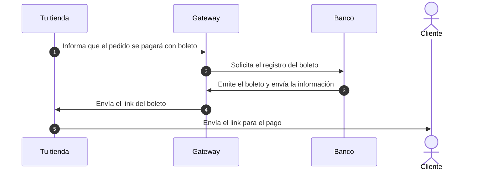
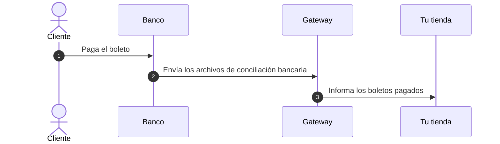

El boleto registrado (Brasil) es uno de los medios de pago que pueden usarse para finalizar compras en tu tienda. Antes de la emisión, el banco registra el boleto con los datos del cliente que realiza la compra, como nombre y documento de identidad, que también se muestran en el boleto. Para impedir que los defraudadores accedan a esa información, la tienda solicita el inicio de sesión del cliente cuando selecciona el boleto como medio de pago y cuando descarga el boleto en la página de confirmación del pedido (**Order Placed**).

Para emitir boletos registrados, tu tienda debe tener un contrato con un banco o proveedor de pagos que emita ese tipo de boleto, registrar el proveedor en el Admin VTEX y crear una condición de pago de boleto procesada por ese proveedor. Los pasos se describen en [Configurar boleto (Brasil)](/es/docs/tutorials/como-configurar-boleto-bancario).

El flujo básico de un pago con boleto registrado se divide en dos partes: [Emisión del boleto](#emision-del-boleto) y [Pago del boleto y conciliación bancaria](#pago-del-boleto-y-conciliacion-bancaria).

## Emisión del boleto

El siguiente diagrama muestra la emisión del boleto, desde la solicitud de tu tienda hasta el envío del link al cliente:

1. Tu tienda informa al gateway que un pedido se pagará vía boleto.
2. El gateway contacta al banco para registrar el boleto.
3. El banco emite el boleto y envía su información al gateway.
4. El gateway genera el link del boleto y lo envía a tu tienda.
5. Tu tienda envía el link del boleto al cliente para que realice el pago.

En este punto el cliente aún no ha pagado el boleto.

## Pago del boleto y conciliación bancaria

El siguiente diagrama muestra el pago del boleto y la conciliación bancaria, desde el pago realizado por el cliente hasta la notificación de tu tienda:

1. El cliente paga el boleto directamente al banco.
2. El banco envía al gateway los archivos de [conciliación bancaria](/es/docs/tutorials/conciliaciones-bancarias) con la información sobre el status de pago de los boletos.
3. El gateway notifica a tu tienda sobre los boletos pagados.

Con esta notificación, el pago se aprueba en VTEX y el envío del pedido puede continuar con normalidad. Hasta entonces el pedido permanece con el status **Pago pendiente** como se describe en [¿Cómo se aprueba el pago de un boleto?](/es/docs/tutorials/como-se-hace-la-aprobacion-de-pago-del-boleto). Si el cliente no paga el boleto antes de la fecha de vencimiento el pedido se cancela según los plazos explicados en [¿En cuánto tiempo un pedido de boleto sin pago se cancela?](/es/docs/tutorials/en-cuanto-tiempo-un-pedido-de-boleto-sin-pago-se-cancela).
