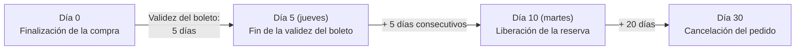

Cuando no se paga el boleto de un pedido, el pedido se cancela automáticamente. El tiempo total hasta la cancelación es la suma de los siguientes plazos:

- [Plazo de validez del boleto](#plazo-de-validez-del-boleto)
- [Plazo para la liberación de la reserva de los productos](#plazo-para-la-liberacion-de-la-reserva-de-los-productos)
- [Plazo para la cancelación del pedido](#plazo-para-la-cancelacion-del-pedido)

## Plazo de validez del boleto

La validez del boleto es el plazo, en días, que tiene el cliente para pagarlo después de la emisión. Después de que el plazo vence el boleto no se puede pagar.

Algunos proveedores de pago permiten configurar la validez del boleto en el Admin VTEX. Para verificar si tu proveedor de pago ofrece esta opción sigue los pasos a continuación:

1. En el Admin VTEX accede a **Configuración de la tienda > Pago > Proveedores**, o ingresa **Proveedores** en la barra de búsqueda en la parte superior de la página.
2. En la pantalla de proveedores ingresa el nombre del proveedor deseado y haz clic en él.
3. En la pantalla de configuración del proveedor, verifica si hay un campo para configurar la validez del boleto.
4. Completa el campo con la validez deseada, en días.
5. Haz clic en `Guardar`.

> ⚠️ Si tu proveedor de pago no permite configurar la validez del boleto en el Admin VTEX, ponte en contacto con el soporte técnico del proveedor para configurarla.

## Plazo para la liberación de la reserva de los productos

Para que un pedido sin pago no afecte la operación de la tienda, la reserva de los productos comprados se libera aunque el pedido siga con el pago pendiente. El plazo para liberar la reserva es la **validez del boleto + cuatro, cinco o seis días consecutivos**, según el día de la semana en que termina la validez:

| Fin de la validez del boleto | Días consecutivos sumados a la validez | Día de liberación de la reserva |
| :--------------------------- | :------------------------------------- | :------------------------------ |
| Domingo                      | 4                                      | Jueves                          |
| Lunes                        | 4                                      | Viernes                         |
| Martes                       | 4                                      | Sábado                          |
| Miércoles                    | 5                                      | Lunes                           |
| Jueves                       | 5                                      | Martes                          |
| Viernes                      | 5                                      | Miércoles                       |
| Sábado                       | 6                                      | Viernes                         |

Para obtener más información sobre la reserva de productos, accede a [Cómo se maneja la reserva](/es/docs/tutorials/como-se-maneja-la-reserva).

## Plazo para la cancelación del pedido

El pedido se cancela 20 días después de la liberación de la reserva, es decir, después del **plazo para la liberación de la reserva + 20 días**.

Por ejemplo, un pedido sin pago cuyo boleto tiene una validez de 5 días, que termina un jueves, se cancela 30 días después de la finalización de la compra:

- Validez del boleto = 5 días.
- Plazo para la liberación de la reserva = 5 + 5 = 10 días.
- Plazo para la cancelación del pedido = 10 + 20 = 30 días.

La siguiente línea de tiempo muestra los plazos de este ejemplo, contados a partir de la finalización de la compra:

Antes de la cancelación puedes aprobar el pago del pedido según se describe en [Aprobar pago de boleto](/es/docs/tutorials/como-aprobar-un-pago). Para cancelar el pedido antes de ese plazo, consulta [Cancelar pedido](/es/docs/tutorials/como-cancelar-pedido).
