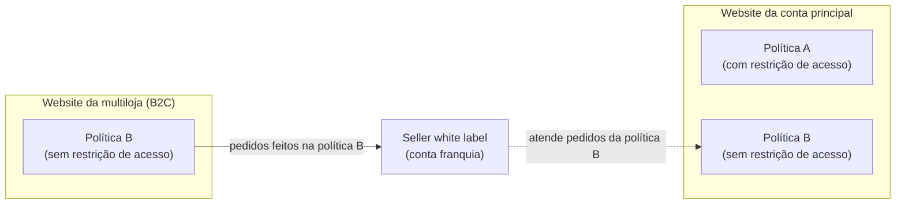
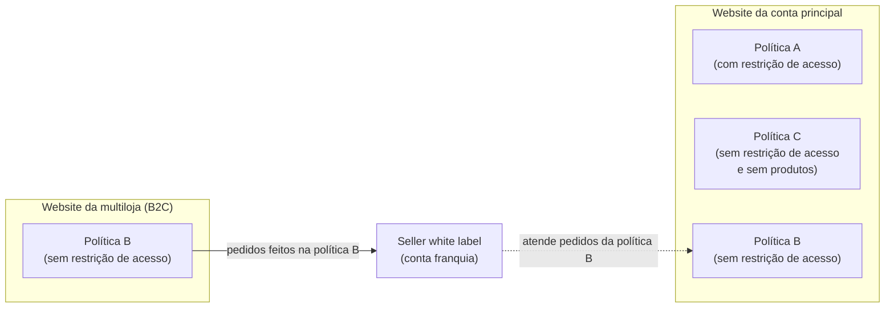

O website da conta principal da minha marca deveria ter acesso restrito, mas usuários não logados visualizam produtos e informações de uma política comercial sem restrição de acesso. Esse problema pode ocorrer quando um [seller white label](/pt/docs/tutorials/seller-white-label), como uma [conta-franquia](/pt/docs/tutorials/o-que-e-conta-franquia), realiza o fulfillment de pedidos de um website da sua loja, como o de uma [multiloja](/pt/docs/tutorials/gerenciando-uma-multiloja).

Este artigo explica a causa desse comportamento e como corrigi-lo sem reorganizar a arquitetura da marca.

## Causa

Para que um seller white label realize o fulfillment de pedidos da sua loja, a política comercial atendida por ele precisa estar elegível no [binding](/pt/docs/tutorials/como-funciona-a-relacao-entre-websites-e-politicas-comerciais#regra-de-elegibilidade) da **conta principal**, mesmo que ele entregue apenas os pedidos de outro website. Estar elegível no binding significa que a política comercial está marcada na configuração do binding do website da conta principal, o que permite que esse website renderize as informações dessa política.

Quando a política comercial da conta principal possui restrição de acesso, como em operações B2B, essa regra se combina com a [exceção à regra de prioridade](/pt/docs/tutorials/como-funciona-a-relacao-entre-websites-e-politicas-comerciais#excecao-a-regra-de-prioridade): se uma política com restrição de acesso estiver acima de uma política elegível sem restrição, a política renderizada será a que não possui restrição. Assim, usuários não logados passam a ver o website da conta principal com as informações da política sem restrição de acesso, que originalmente se destinava a outro website.

### Exemplo

Considere uma marca com a seguinte arquitetura:

- **Website da conta principal:** política A (com restrição de acesso). Apenas a política A está elegível no binding desse website, e ela tem estoque próprio.
- **Website da multiloja:** política B (sem restrição de acesso). Apenas a política B está elegível no binding desse website. O catálogo é compartilhado com a conta principal. A política B não possui restrição de acesso porque, neste exemplo, ela atende um website adicional B2C, que precisa estar acessível a usuários não logados.
- **Seller white label:** conta-franquia que realiza o fulfillment apenas dos pedidos feitos na política B.

Para que o seller white label entregue os pedidos da multiloja, a política B precisa estar elegível também no binding da conta principal. O diagrama a seguir ilustra essa arquitetura:

A ordenação das políticas comerciais está configurada da seguinte forma:

1. Política A (com restrição de acesso).
2. Política B (sem restrição de acesso).

Pela regra de prioridade, o website da conta principal renderizaria a política A, que está no topo da ordenação. No entanto, como a política A possui restrição de acesso e a política B, que está abaixo dela, não possui, entra em vigor a exceção à regra de prioridade. Como resultado, usuários não logados, que não atendem às condições de acesso da política A, veem o website da conta principal com as informações da política B.

## Solução

Para que usuários não logados não vejam as informações da política B no website da conta principal, crie uma política comercial sem produtos e posicione-a acima da política B. Siga os passos a seguir:

1. [Crie uma nova política](/pt/docs/tutorials/criar-uma-politica-comercial) comercial C, sem restrição de acesso.
2. Torne a política C elegível no binding da conta principal. Saiba como no **passo 8** do artigo [Vincular uma loja a uma estrutura de pastas do CMS (binding)](/pt/docs/tutorials/vincular-um-account-name-a-um-website-binding).
3. Em seu Admin VTEX, acesse **Configurações da loja > Canais > Políticas Comerciais**.
4. Na coluna **Posição**, posicione a política C acima da política B.
5. Não disponibilize produtos para a política C.

Com essa configuração, a ordenação das políticas comerciais fica da seguinte forma:

1. Política A (com restrição de acesso).
2. Política C (sem restrição de acesso e sem produtos).
3. Política B (sem restrição de acesso).

O diagrama a seguir ilustra essa configuração. A política C fica elegível no binding da conta principal, entre a política A e a política B, e não possui produtos:

Dessa forma, usuários não logados acessam o website da conta principal sem produtos, pois a política C (sem restrição de acesso) é renderizada. A política B permanece elegível nesse binding para que o seller white label realize o fulfillment dos pedidos da multiloja, mas não é renderizada porque está abaixo da política C na ordenação. Após o login, usuários que atendem às condições de restrição de acesso veem os produtos com as informações da política A.
