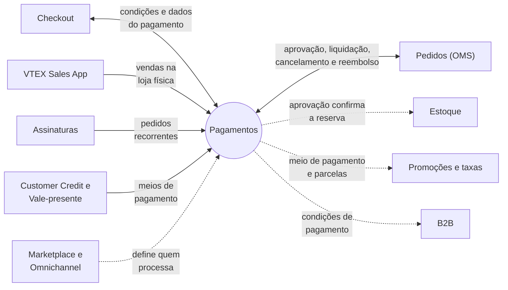
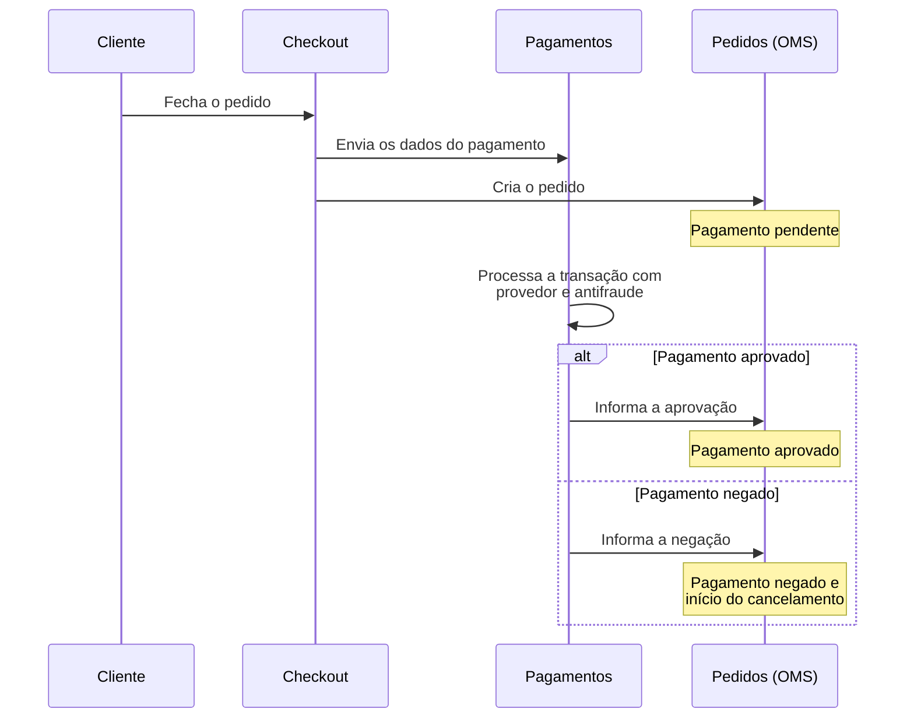
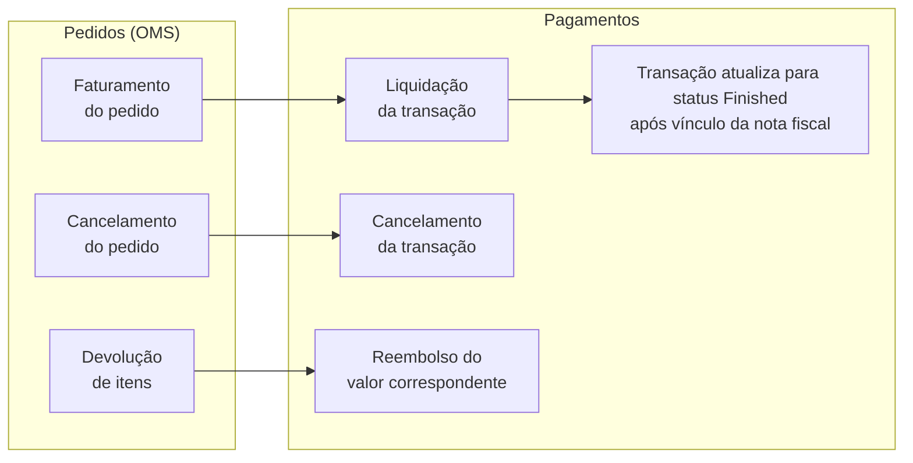
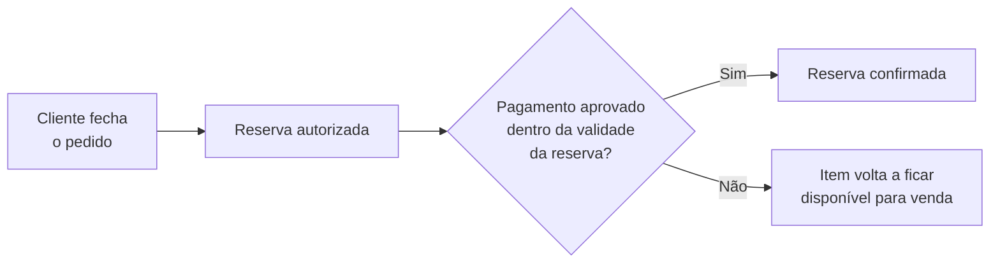
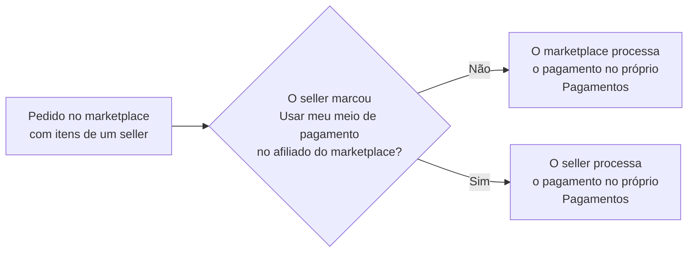

Neste artigo, você entende como o módulo de Pagamentos troca informações com os demais módulos da VTEX ao longo da vida de um pedido: o que ele recebe de cada módulo, o que devolve e quais configurações de um módulo afetam o comportamento do outro.

Esse conhecimento ajuda a identificar por que um pedido ou uma transação mudou de status e em qual módulo você deve atuar para resolver um problema.

## O papel do módulo Pagamentos na plataforma

Pagamentos é o módulo responsável por gerenciar o fluxo financeiro da sua loja, o que inclui a comunicação com os provedores de pagamento e de antifraude.

Para processar uma transação do início ao fim, o Pagamentos depende de dois módulos. O Checkout envia os dados do pagamento quando o cliente fecha o pedido. Depois, as ações feitas no pedido por meio do sistema de gerenciamento de pedidos (OMS), como faturamento, cancelamento e devolução de itens, determinam quando o Pagamentos liquida, cancela ou reembolsa a transação.

A relação também funciona no sentido inverso. Depois que o pagamento é aprovado, o pedido avança no fluxo, a reserva dos itens no estoque é confirmada e serviços como Assinaturas são ativados.

Para conhecer os agentes que participam do fluxo, como gateway, adquirente e antifraude, consulte [Agentes financeiros no fluxo de pagamento](/pt/docs/tutorials/agentes-financeiros-no-fluxo-de-pagamento). Para entender cada status de uma transação, consulte [Fluxo da transação no Pagamentos](/pt/docs/tutorials/fluxo-da-transacao-no-pagamentos).

## Visão geral das integrações

O diagrama a seguir mostra como o Pagamentos se conecta aos demais módulos. As setas contínuas indicam troca direta de informações, e as setas tracejadas indicam que o outro módulo usa uma configuração ou um resultado do Pagamentos:

A tabela a seguir resume a relação entre Pagamentos e os demais módulos:

| Módulo | O que o Pagamentos recebe | O que o Pagamentos fornece |
| --- | --- | --- |
| Checkout | Dados do pagamento escolhido pelo cliente | Condições de pagamento disponíveis para a compra |
| Promoções e taxas | Não se aplica | Meio de pagamento e número de parcelas, usados como condição de promoções |
| Pedidos (OMS) | Solicitações de liquidação, cancelamento e reembolso | Aprovação ou negação do pagamento |
| Estoque | Não se aplica | Aprovação do pagamento, que confirma a reserva |
| Marketplace e Omnichannel | Definição de qual conta processa o pagamento | Confirmação do pagamento para marketplace, seller ou chain |
| Assinaturas | Pedidos recorrentes gerados a cada ciclo | Aprovação do pagamento, que ativa a assinatura |
| B2B | Não se aplica | Condições de pagamento que podem ser atribuídas a organizações |
| Customer Credit e Vale-presente | Meios de pagamento que operam dentro do Pagamentos | Transações processadas como as de qualquer outro meio |
| VTEX Sales App | Vendas feitas na loja física | Condições de pagamento usadas no checkout do Sales App |

As seções a seguir detalham cada uma dessas integrações.

## Checkout

O Checkout é o ponto de entrada do Pagamentos. As [condições de pagamento](/pt/docs/tutorials/condicoes-de-pagamento) que você configura no Pagamentos são as opções que o cliente vê na etapa de pagamento do Checkout.

Algumas configurações do Pagamentos determinam o que aparece para o cliente:

- __Condições especiais:__ restringem uma condição de pagamento por condição comercial dos SKUs, política comercial, banco emissor ou período. Assim, um mesmo carrinho pode mostrar opções diferentes conforme os produtos e o contexto da compra. Com a política comercial, por exemplo, você pode oferecer um meio de pagamento exclusivo em determinado contexto, sem customizar o Checkout. Consulte [Configurar condições especiais de pagamento](/pt/docs/tutorials/condicoes-especiais) e [Omitir uma condição de pagamento](/pt/docs/tutorials/como-omitir-uma-condicao-de-pagamento).
- __Ordem de exibição:__ por padrão, o Checkout mostra as condições de pagamento na ordem em que foram cadastradas no Pagamentos. Meios que dependem de dados retornados pela afiliação aparecem no fim da lista. Consulte [Modificar a ordem de meios de pagamento no checkout](/pt/docs/tutorials/como-modificar-a-ordem-de-meios-de-pagamento-no-checkout).

Quando o cliente fecha o pedido, o Checkout envia as informações do pagamento ao gateway e a transação é criada no Pagamentos. A partir desse momento, o processamento do pagamento é responsabilidade do Pagamentos.

Saiba mais em [O que é checkout transparente?](/pt/docs/tutorials/o-que-e-checkout-transparente).

## Promoções e taxas

O módulo de Promoções usa informações do pagamento como condição para aplicar descontos. Em uma promoção regular, você pode exigir que o cliente use determinados meios de pagamento ou que o pedido tenha um número de parcelas dentro de um intervalo definido.

Essas condições têm as seguintes limitações:

- A promoção por meio de pagamento só é aplicada quando há um único meio de pagamento no carrinho.
- A condição por número de parcelas não se aplica a boleto, vale-presente ou pedidos com mais de um meio de pagamento.

O desconto de preço à vista é um exemplo dessa integração. A promoção define o desconto para um meio de pagamento, e o ID desse meio, que aparece nas condições de pagamento do Pagamentos, é usado para calcular e exibir o preço à vista na loja.

Saiba mais nos artigos a seguir:

- [Criar uma promoção regular](/pt/docs/tutorials/promocao-regular-pt#3-quais-as-condicoes-para-a-promocao-ser-valida)
- [Configurar desconto de preço à vista](/pt/docs/tutorials/configurar-desconto-de-preco-a-vista)

## Pedidos (OMS)

O sistema de gerenciamento de pedidos (OMS) troca informações com o Pagamentos nos dois sentidos: o Pagamentos informa ao OMS o resultado da transação, e o OMS solicita ao Pagamentos a liquidação, o cancelamento ou o reembolso dessa transação.

### Do Pagamentos para o OMS

Depois que o pedido é fechado, ele fica com o status `Pagamento pendente` enquanto o Pagamentos processa a transação. O resultado da transação define o próximo passo do pedido:

- __Pagamento aprovado:__ o pedido passa para `Pagamento aprovado`, segue para a janela de cancelamento e, depois, fica pronto para manuseio.
- __Pagamento negado:__ o pedido passa para `Pagamento negado` e a plataforma inicia o cancelamento automaticamente.

O diagrama a seguir mostra a troca de informações entre Checkout, Pagamentos e OMS desde o fechamento do pedido até a resposta do Pagamentos:

Para conhecer todos os status do pedido e as diferenças entre os fluxos de marketplace e de seller, consulte [Fluxo e status de pedidos](/pt/docs/tutorials/fluxo-e-status-de-pedidos).

### Do OMS para o Pagamentos

As ações feitas no pedido geram operações na transação. O diagrama a seguir mostra, para cada ação no OMS, a operação que ela gera no Pagamentos:

Veja como cada ação afeta a transação:

- __Faturamento:__ quando o pedido é faturado, o Pagamentos liquida o valor da transação. A soma das notas fiscais deve corresponder ao valor total do pedido. Depois que a nota fiscal é vinculada ao pedido, a transação chega ao status `Finished`. Consulte [Como faturar um pedido](/pt/docs/tutorials/faturar-um-pedido-manualmente).
- __Cancelamento:__ quando um pedido é cancelado, o Pagamentos é notificado e cancela a transação. O pedido fica com o status `Cancelando` até que o Pagamentos conclua a operação e, então, passa para `Cancelado`. O ressarcimento ao cliente depende do estágio do pagamento e do meio utilizado.
- __Devolução de itens:__ quando há devolução parcial ou total de itens, o OMS solicita ao Pagamentos o reembolso do valor correspondente. Pagamentos feitos por boleto são uma exceção, porque não podem ser reembolsados dessa forma. Consulte [Funcionamento do estorno quando há devolução do item](/pt/docs/tutorials/como-funciona-estorno-quando-ha-devolucao-do-item).

> ℹ️ A forma como o Pagamentos repassa ao provedor as liquidações, os cancelamentos e os reembolsos parciais depende do modo de processamento configurado para cada conector. Consulte [Operações de pagamentos pós-compra](/pt/docs/tutorials/operacoes-de-pagamentos-pos-compra).

O Pagamentos também tem regras próprias que não dependem de uma ação no OMS. Em pagamentos com cartão de crédito, por exemplo, a liquidação automática acontece depois de um tempo máximo, mesmo que o pedido ainda não tenha sido faturado.

Saiba mais nos artigos a seguir:

- [Tipos de liquidação de pagamento](/pt/docs/tutorials/tipos-de-liquidacao-de-pagamento)
- [Configurar tempo máximo para liquidação automática](/pt/docs/tutorials/configurar-tempo-maximo-para-liquidacao-automatica)
- [Reembolso de pagamentos](/pt/docs/tutorials/reembolso-de-pagamentos)

## Estoque

O status da reserva dos itens no estoque muda conforme o pagamento avança:

1. Quando o cliente fecha o pedido, o item passa para __Reserva autorizada__. A unidade não pode ser vendida novamente, mas o pagamento ainda não foi aprovado.
2. Quando o Pagamentos aprova o pagamento, o item passa para __Reserva confirmada__ e deixa de ter prazo de validade.
3. Se o pagamento não for aprovado dentro da validade da reserva, o item volta a ficar disponível para venda.

O diagrama a seguir resume esse fluxo:

A validade da reserva soma o prazo de expiração do pagamento e o tempo de reserva no estoque. Para boleto e promissória, o prazo de expiração do pagamento é configurado no Pagamentos. Por isso, alterar esse prazo também altera por quanto tempo o item fica reservado. Para os demais meios, como cartão de crédito e carteiras digitais, não é possível configurar esse prazo.

Saiba mais nos artigos a seguir:

- [Como a reserva funciona](/pt/docs/tutorials/como-a-reserva-funciona)
- [Em quanto tempo um pedido de boleto sem pagamento é cancelado?](/pt/docs/tutorials/em-quanto-tempo-um-pedido-de-boleto-sem-pagamento-e-cancelado)
- [Configurar pagamentos com Promissória](/pt/docs/tutorials/configurar-pagamentos-com-promissoria)

## Marketplace e Omnichannel

Em operações com mais de uma conta, é preciso definir qual conta processa o pagamento. Essa definição é feita na configuração de afiliado do OMS, pela opção __Usar meu meio de pagamento__:

- __Marketplace processando pagamentos:__ o marketplace configura provedores, condições de pagamento e antifraude no próprio Pagamentos, e o seller deixa a opção __Usar meu meio de pagamento__ desmarcada.
- __Seller processando pagamentos:__ o seller configura o próprio Pagamentos e marca a opção __Usar meu meio de pagamento__ no afiliado do marketplace. Esse cenário também se aplica a lojas físicas cadastradas como Seller White Label, que podem enviar os próprios meios de pagamento para o checkout do marketplace.

O diagrama a seguir mostra como essa opção define qual conta processa o pagamento:

Quando um pedido tem itens de vários sellers, o valor pode ser dividido automaticamente entre eles pelo split de pagamento.

Dois cenários omnichannel têm regras específicas:

- __Conta franquia:__ por padrão, usa os meios de pagamento da conta principal, mas pode ser configurada para usar meios próprios.
- __Multilevel Omnichannel Inventory:__ a loja da camada intermediária (chain) não recebe a confirmação de pagamento diretamente do gateway. Quem informa essa confirmação ao chain é o marketplace.

Saiba mais nos artigos a seguir:

- [Pagamentos em marketplaces VTEX](/pt/docs/tutorials/pagamentos-em-marketplaces-vtex)
- [Split de Pagamento](/pt/docs/tutorials/split-de-pagamento)
- [Enviar os meios de pagamento do Seller White Label para o Marketplace](/pt/docs/tutorials/enviar-os-meios-de-pagamento-do-seller-white-label-para-o-marketplace)
- [O que é conta franquia?](/pt/docs/tutorials/o-que-e-conta-franquia)
- [Multilevel Omnichannel Inventory](/pt/docs/tutorials/multilevel-omnichannel-inventory)

## Assinaturas

O app de Assinaturas refaz o pedido automaticamente na frequência escolhida pelo cliente. Cada pedido gerado pela assinatura passa pelo Pagamentos como qualquer outro pedido.

A integração entre Assinaturas e Pagamentos tem três pontos principais:

- __Meios de pagamento aceitos:__ apenas os meios habilitados para Assinaturas podem ser usados nesses pedidos.
- __Ativação:__ a assinatura só é ativada depois que o pagamento do primeiro pedido é aprovado.
- __Cobrança recorrente com cartão de crédito:__ os pedidos seguintes usam os dados do cartão da primeira compra, de forma tokenizada e sem o código de segurança (CVV). Por isso, o adquirente da sua loja precisa aceitar transações recorrentes, e você deve solicitar essa liberação a ele.

Saiba mais nos artigos a seguir:

- [Assinaturas](/pt/docs/tutorials/como-funciona-a-assinatura)
- [Como configurar Assinaturas na sua loja](/pt/docs/tutorials/como-configurar-assinaturas)

## B2B

No B2B Suite, as condições de pagamento são atribuídas à organização compradora. Toda condição de pagamento configurada no Pagamentos fica disponível para ser associada a uma organização. As condições associadas são as únicas que os usuários dessa organização veem no checkout.

O administrador da organização também pode personalizar as opções de pagamento disponíveis em cada centro de custo.

Saiba mais em [Configurando condições de pagamento B2B (B2B Suite)](/pt/docs/tutorials/configurando-condicoes-de-pagamento-b2b).

## Customer Credit e Vale-presente

Alguns meios de pagamento são oferecidos pela própria VTEX e funcionam dentro do Pagamentos, sem depender de um adquirente externo:

- __Customer Credit:__ app que permite oferecer crédito aos clientes que você selecionar. Depois de instalado, aparece como opção de pagamento no Checkout apenas para esses clientes, com o valor de crédito disponível. Você gerencia contas, limites e títulos de cobrança no próprio app.
- __Vale-presente:__ recurso do Pagamentos usado para abater parte ou todo o valor de um pedido. O cliente informa o código do vale no Checkout. Também é possível integrar um provedor de vale-presente externo, como um programa de fidelidade.

Saiba mais nos artigos a seguir:

- [Customer Credit](/pt/docs/tutorials/customer-credit-visao-geral)
- [Configurar Vale-presente](/pt/docs/tutorials/gift-card)
- [Como integrar um provedor de Gift Card externo à VTEX](/pt/docs/tutorials/como-integrar-um-provedor-de-gift-card-externo-a-vtex)

## VTEX Sales App

As vendas feitas pelo VTEX Sales App também geram transações no Pagamentos. Para receber pagamentos na loja física, você ativa o provedor e configura as condições de pagamento no Pagamentos, da mesma forma que no ecommerce.

Os meios de pagamento exibidos no checkout do Sales App são filtrados a partir dos IDs das condições de pagamento cadastradas no Pagamentos. Na modalidade de pagamento com cartão sem maquininha, a compra é processada pelo mesmo gateway do ecommerce.

Saiba mais nos artigos a seguir:

- [Configurar métodos de pagamento para o VTEX Sales App](/pt/docs/tracks/configurar-metodos-de-pagamento-para-o-vtex-sales-app)
- [Definir meios de pagamento exibidos no VTEX Sales App](/pt/docs/tracks/definir-meios-de-pagamento-exibidos-no-vtex-sales-app)
- [Pagamento com cartão via Sales App (sem maquininha)](/pt/docs/tutorials/pagamento-com-cartao-via-sales-app-sem-maquininha)
