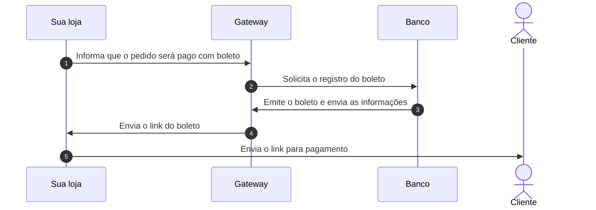
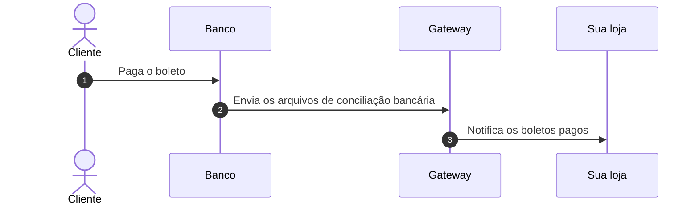

O boleto bancário registrado é um dos meios de pagamento que podem ser utilizados para o fechamento de compras em sua loja. Antes da emissão, o banco registra o boleto com os dados do cliente que está realizando a compra, como nome e CPF, e esses dados também são exibidos no boleto. Para impedir que fraudadores acessem essas informações, a loja solicita o login do cliente quando ele escolhe o boleto registrado como meio de pagamento e quando baixa o boleto na página de confirmação do pedido (**Order Placed**).

Para emitir boletos registrados, sua loja precisa ter contrato com um banco ou provedor de pagamento que emita esse tipo de boleto, cadastrar esse provedor no Admin VTEX e criar uma condição de pagamento de boleto bancário processada por ele. Os passos estão em [Configurar boleto bancário](/pt/docs/tutorials/como-configurar-boleto-bancario).

O fluxo básico de um pagamento com boleto registrado é dividido em duas partes: [Emissão do boleto](#emissao-do-boleto) e [Pagamento do boleto e conciliação bancária](#pagamento-do-boleto-e-conciliacao-bancaria).
 
## Emissão do boleto

O diagrama a seguir mostra a emissão do boleto, da solicitação da sua loja até o envio do link ao cliente:

1. Sua loja informa ao gateway que um pedido será pago através de boleto bancário.
2. O gateway entra em contato com o banco para realizar o registro do boleto.
3. O banco emite o boleto e envia suas informações para o gateway.
4. O gateway gera o link do boleto e envia para sua loja.
5. Sua loja envia o link do boleto para seu cliente realizar o pagamento.

Neste momento, o boleto ainda não foi pago pelo cliente.

## Pagamento do boleto e conciliação bancária

O diagrama a seguir mostra o pagamento do boleto e a conciliação bancária, do pagamento feito pelo cliente até a notificação da sua loja:

1. O cliente paga o boleto diretamente ao banco.
2. O banco envia para o gateway os arquivos de [conciliação bancária](/pt/docs/tutorials/conciliacoes-bancarias) com as informações sobre o status de pagamento dos boletos.
3. O gateway notifica sua loja sobre os boletos pagos.

Com essa notificação, o pagamento é aprovado na VTEX e a entrega do pedido pode prosseguir normalmente. Até lá, o pedido permanece com o status __Pagamento Pendente__, como descrito em [Como é feita a aprovação de pagamento do boleto?](/pt/docs/tutorials/como-e-feita-a-aprovacao-de-pagamento-do-boleto). Se o cliente não pagar o boleto até o vencimento, o pedido é cancelado após os prazos explicados em [Em quanto tempo um pedido de boleto sem pagamento é cancelado?](/pt/docs/tutorials/em-quanto-tempo-um-pedido-de-boleto-sem-pagamento-e-cancelado).
