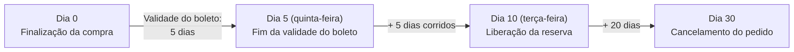

Quando o boleto de um pedido não é pago, o pedido é cancelado automaticamente. O tempo total até esse cancelamento é a soma dos seguintes prazos:

- [Prazo de validade do boleto](#prazo-de-validade-do-boleto)
- [Prazo para liberação da reserva dos produtos](#prazo-para-liberacao-da-reserva-dos-produtos)
- [Prazo para cancelamento do pedido](#prazo-para-cancelamento-do-pedido)

## Prazo de validade do boleto

A validade do boleto é o prazo, em dias, que o cliente tem para pagar o boleto após a emissão. Quando a validade termina, o boleto não pode mais ser pago.

Alguns provedores de pagamento permitem configurar a validade do boleto no Admin VTEX. Para verificar se o seu provedor de pagamento oferece essa opção, siga os passos abaixo:

1. No Admin VTEX, acesse __Configurações da loja > Pagamentos > Provedores__, ou digite __Provedores__ na barra de busca no topo da página.
2. Na tela de provedores, digite o nome do provedor desejado e clique sobre ele.
3. Na tela de configuração do provedor, verifique se existe um campo para configurar a validade do boleto.
4. Preencha o campo com a validade desejada, em dias.
5. Clique em `Salvar`.

> ⚠️ Caso o seu provedor de pagamento não permita configurar a validade do boleto no Admin VTEX, entre em contato com o suporte técnico do provedor para configurá-la.

## Prazo para liberação da reserva dos produtos

Para que um pedido sem pagamento não afete a operação da loja, a reserva dos produtos comprados é liberada mesmo que o pedido continue com o pagamento pendente. O prazo para a liberação da reserva é a **validade do boleto + quatro, cinco ou seis dias corridos**, conforme o dia da semana em que a validade termina:

| Fim da validade do boleto | Dias corridos somados à validade | Dia da liberação da reserva |
| :--- | :--- | :--- |
| Domingo | 4 | Quinta-feira |
| Segunda-feira | 4 | Sexta-feira |
| Terça-feira | 4 | Sábado |
| Quarta-feira | 5 | Segunda-feira |
| Quinta-feira | 5 | Terça-feira |
| Sexta-feira | 5 | Quarta-feira |
| Sábado | 6 | Sexta-feira |

Para mais informações sobre a reserva de produtos, acesse [Como a reserva funciona](/pt/docs/tutorials/como-a-reserva-funciona).

## Prazo para cancelamento do pedido

O pedido é cancelado 20 dias após a liberação da reserva, ou seja, no **prazo para liberação da reserva + 20 dias**.

Por exemplo, um pedido sem pagamento cujo boleto tem validade de 5 dias, terminando em uma quinta-feira, é cancelado 30 dias após a finalização da compra:

- Validade do boleto = 5 dias.
- Prazo para liberação da reserva = 5 + 5 = 10 dias.
- Prazo para cancelamento do pedido = 10 + 20 = 30 dias.

A linha do tempo a seguir mostra os prazos desse exemplo, contados a partir da finalização da compra:

Até o cancelamento, você ainda pode aprovar o pagamento do pedido, conforme descrito em [Aprovar pagamento de boleto](/pt/docs/tutorials/como-aprovar-pagamento). Para cancelar o pedido antes desse prazo, acesse [Cancelar pedido](/pt/docs/tutorials/como-cancelar-pedido).
